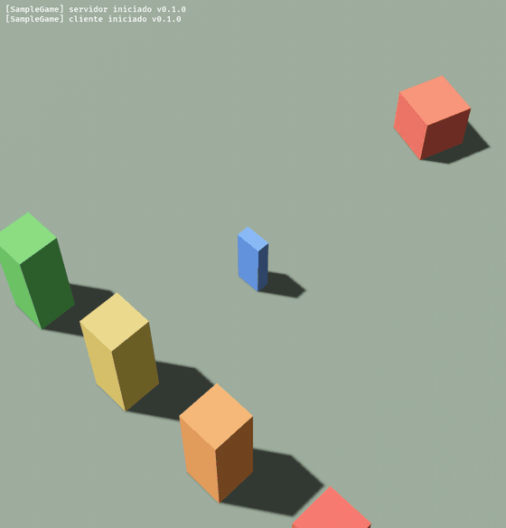

# RUBIX Studio

**A lightweight studio for developing and running games, written in Rust, for Linux.**

[Português](README.pt-BR.md)



*A sample game (`studio/harness/sample-game`) loaded through Rojo and run by Luau. The red cube is moved by a script. Saving a file changes its color to green without restarting the window ("hot reload"). Right click moves the blue character.*

The idea is simple: the Roblox Studio workflow (Luau scripts, a tree of Instances, [Rojo](https://github.com/rojo-rbx/rojo) sync, any editor you like) working on Linux, without depending on Roblox to play and test. You write the game as code, the engine opens a window, runs the scripts and shows the result in 3D.

## Why this exists

- Roblox Studio does not run on Linux. People who develop with it need Windows, macOS, or workarounds.
- For a game written entirely as code, a full editor is heavy. What you want is a short loop: save a file, see the result in under a second.
- A small, open, readable runtime also lets you test game logic with automated tests, without opening a window.

This is **not a Roblox clone and does not promise parity**. It is a runtime compatible with the subset of the API that the target games actually use, and that subset grows as new games are tried. Known differences are written down in [`studio/docs/`](studio/docs/).

## How it works

```
 game files ──► rojo serve ──► Rojo client (Rust) ──► DataModel ──► Luau (mlua) ──► renderer (Bevy / Vulkan)
```

| Crate | What it does |
|---|---|
| `studio/crates/dom` | DataModel: the tree of Instances (on top of `rbx_dom_weak`). |
| `studio/crates/rojo-client` | Rojo protocol (v5) client: handshake, tree read, WebSocket and live patches. |
| `studio/crates/lua` | Luau bridge: `Instance`, data types, `require`, `script`, `task.*` on a virtual clock, and a read-only view of the Parts for the renderer. |
| `studio/crates/app` | Bevy window: draws the Parts, isometric camera, right-click-to-walk, on-screen console, hot reload. |

Stack: Rust, [Bevy](https://bevyengine.org) (wgpu/Vulkan), [mlua](https://github.com/mlua-rs/mlua) (Luau), [rbx-dom](https://github.com/rojo-rbx/rbx-dom), and [Lune](https://github.com/lune-org/lune) for data types and as a test oracle.

## Status

Measured on Arch Linux, Intel UHD GPU, Wayland.

**Works and is tested**
- Live Rojo client: saving a file reaches the DataModel in about 66 ms (test against a real `rojo serve`).
- Luau scripts: `Instance.new`, `require` between modules, `script.Parent`, `game:GetService`, `task.spawn` / `task.wait` on a deterministic clock, script errors isolated and logged.
- The Parts a script creates are drawn in 3D (Block, Ball, Cylinder; position, rotation, size, color, transparency) and follow the script every frame.
- Hot reload: a Rojo patch rebuilds the world with the new code.
- 3D window at ~60 FPS, isometric camera with zoom, right click to walk at 16 studs/s.

**Not done yet**
- Physics and collision, `Humanoid`, real `UserInputService`, GUI, sound.
- `part.Position` is not derived from `CFrame` yet (a gap in the library we build on; see [`decisions.md`](studio/docs/decisions.md)).
- The server/client split: today every Script and LocalScript runs in one Luau state.
- Visual effects (particles, glow, bloom).
- Characters: either a blocky rig built from primitives or a model with an open license.

## Rules of the project

- **Clean-room.** Only public, open sources. No decompiling and no copying binaries, models, meshes, textures or sounds from Roblox, and no copies of them found on the internet. Third-party assets only with a clear open license (CC0, CC-BY, ...), recorded with author, link and license.
- **No panics at runtime.** In the game-execution crates `unwrap`, `expect` and `panic` are blocked by clippy. A script error must never close the window.
- **Unconfirmed data is marked "to confirm"**, never an invented number.
- **Numbers over opinions.** Behavior becomes a test.

## Try it

Requirements (Arch): `sudo pacman -S --needed base-devel git clang cmake rustup python vulkan-intel vulkan-tools`, then `rustup default stable`.

```bash
./setup.sh                      # clones the references and installs lune and rojo
cd studio
cargo test --workspace          # tests (the first build of Bevy takes a long time)

# run the sample game with live reload
rojo serve harness/sample-game/default.project.json &
STUDIO_ROJO=http://127.0.0.1:34872 cargo run -p app
```

Edit `harness/sample-game/src/shared/Config.luau` (for example the cube color) while the window is open.

The app also has a test mode driven by environment variables: `STUDIO_CLICKS` (inject right clicks), `STUDIO_SHOTS` (screenshots of the window only) and `STUDIO_EXIT_AFTER` (print FPS and final position).

## Documentation

- [`studio/docs/decisions.md`](studio/docs/decisions.md): decisions, licenses, and what we learned from the libraries.
- [`studio/docs/rojo-protocol.md`](studio/docs/rojo-protocol.md): the Rojo protocol as the engine uses it.
- [`studio/docs/bug-prevention.md`](studio/docs/bug-prevention.md): rules against bugs.
- [`studio/docs/good-first-issues.md`](studio/docs/good-first-issues.md): small tasks to start with.
- [`CONTRIBUTING.md`](CONTRIBUTING.md): how to contribute, including the clean-room rule.

## License

Dual-licensed under [MIT](LICENSE-MIT) or [Apache-2.0](LICENSE-APACHE), at your option. Rojo and Lune are MPL-2.0 and are used only as dependencies or binaries; no files from them are copied here.

This project is not affiliated with, endorsed by, or sponsored by Roblox Corporation. "Roblox" is a trademark of its owner.
